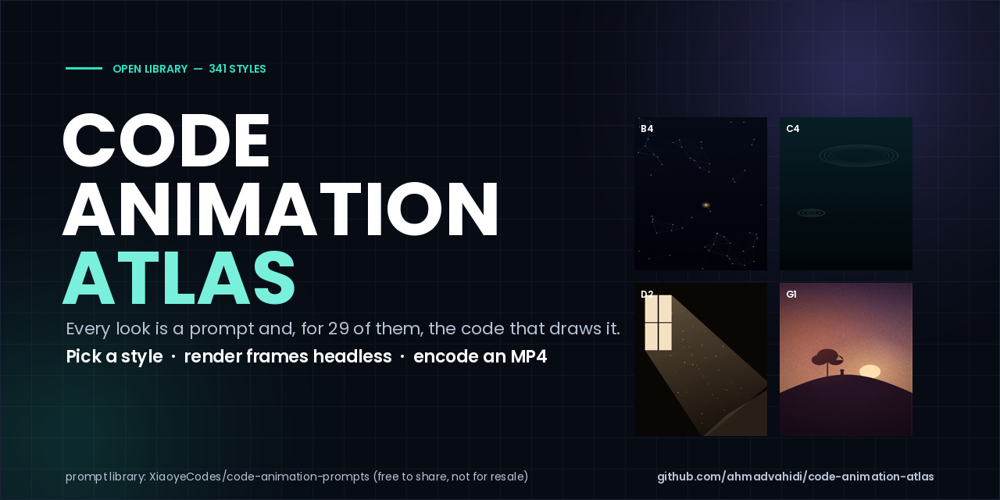
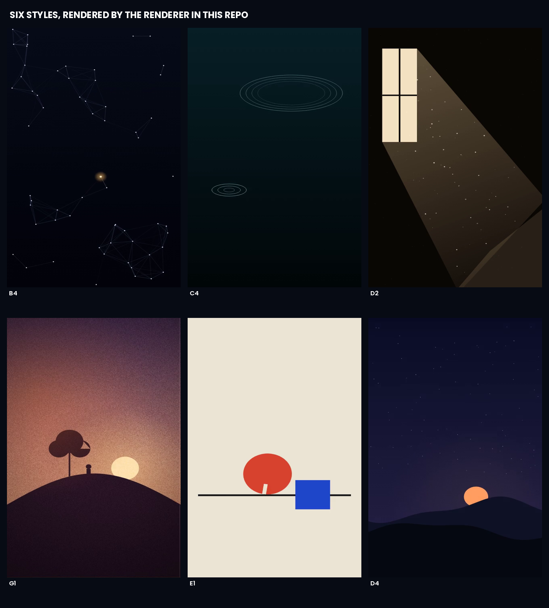

<div align="center">



**۳۴۱ سبک برای اینکه یک ویدیو «چه شکلی» باشد — و کدِ ۲۸ تای آن‌ها.**

[English](README.md) · [فهرست سبک‌ها](INDEX.md) · [نمونهٔ ۱۵ ثانیه‌ای](preview/sample-15s.mp4)

</div>

---

<div dir="rtl" align="right">

## این مخزن چیست

کتابخانه‌ای از **۳۴۱ سبک انیمیشنِ کد-محور**. هر سبک پیش از نوشتن یک خط کد حرکت، به سه سؤال جواب می‌دهد:
چه شکلی است، برای چه حسی مناسب است، کلیدواژه‌هایش چیست. **۲۸ سبک** علاوه بر پرامپت، پیاده‌سازی
اجرایی Canvas 2D هم دارند — یعنی «حسِ این را بده» تبدیل می‌شود به یک فراخوانی تابع، نه یک پرامپت به
مدل ویدیو.

شش فریمِ زیر ماکت نیستند؛ با `tools/render_style.py` از همان کدِ داخل `styles/` رندر شده‌اند:



## شروع سریع

```bash
git clone https://github.com/ahmadvahidi/code-animation-atlas.git && cd code-animation-atlas

python3 tools/pick_style.py "calm ending hope" --coded-only    # پیشنهاد سبک بر اساس موضوع
python3 tools/render_style.py B5 --out clip.mp4 --frames 36 --size 720x1280 --duration 3
python3 tools/make_sample.py --out sample.mp4                  # همان برشِ ۱۵ ثانیه‌ای پنج‌سینه
```

فقط `python3`، `ffmpeg` و یک باینری Chromium لازم است (`CHROME_BIN`). بدون playwright، بدون node، بدون نمایشگر.

## داخلش چیست

| گروه | تعداد | چیست |
|---|:--:|---|
| A–G نمونهٔ کد | ۲۶ | هستهٔ کددار: تایپوگرافی، ذرات، جوهر، نور، هندسه |
| M موشن | ۴۰ | بافت‌های حرکت و الگوهای تایمینگ |
| K کارتونی | ۳۸ | ظاهرهای کارتونی و تصویرسازی |
| Z چینی | ۱۵ | جوهر، کاغذبُری، پالت شرقی |
| H چیدمان | ۱۲ | ترکیب‌بندی‌های آماده برای متن و داده |
| L Lemo-Opuscar | ۵۹ | مجموعهٔ منتخب ظاهرهای محصول/فیلم |
| V mg-styles | ۱۵ | سبک‌های مرجع موشن‌گرافیک |
| X code-video | ۳۱ | کد به‌عنوان تصویر: ترمینال، لاگ، آرت کاراکتری |
| R از روی مرجع | ۷ | از آثار مرجع مشخص بازسازی شده |
| O اسکار ۹۸ | ۹۸ | ۹۸ ظاهر برگرفته از فیلم |

## لایسنس — دو بخش، هر دو مهم

- **کتابخانهٔ سبک‌ها** (پرامپت، توضیح، کد مرجع) از
  [`XiaoyeCodes/code-animation-prompts`](https://github.com/XiaoyeCodes/code-animation-prompts) می‌آید و
  شرایط خودش را دارد: **استفاده و بازنشر آزاد، فروش و بسته‌بندی به‌عنوان محصول/دوره ممنوع**، با ذکر منبع.
  متن کامل: [UPSTREAM-LICENSE.md](UPSTREAM-LICENSE.md).
- **ابزار این مخزن** (`tools/` و تصاویر) MIT است — [LICENSE](LICENSE).

یعنی: برای ساختن ویدیو آزاد است؛ برای فروشِ خودِ کتابخانه نه.

## چطور ساخته شد

آینه‌برداری از بالادست در کامیت `main` (۲۹ اکتبر ۲۰۲۶)، فقط پرامپت‌ها (۱۹۳ استیل مرجع ۸۰ مگابایت است و
بالادست می‌ماند). فایل‌ها یکی‌یکی گرفته شد، توابع مشترک Canvas در `styles/_shared.js` جمع شد، و هر سینِ
نمونه محلی رندر شد — کنترل کیفیت با اسکن نورِ فریم‌به‌فریم و خواندن پنج فریم نمونه انجام شد، نه با نگاه
به تامبنیل.

</div>
