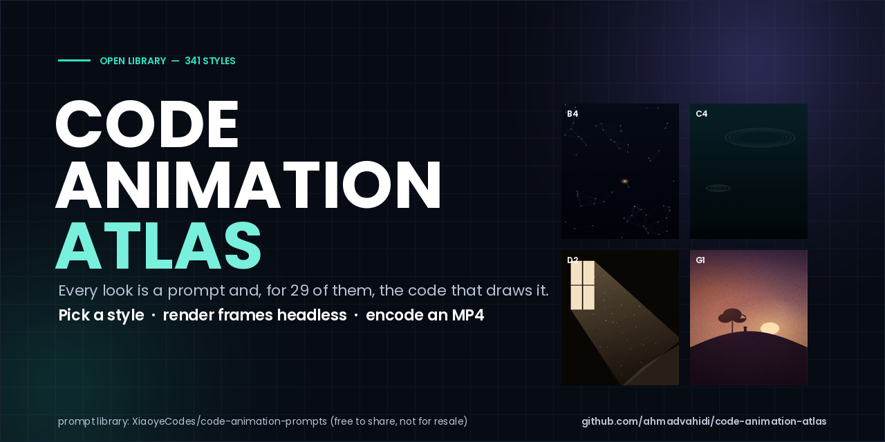
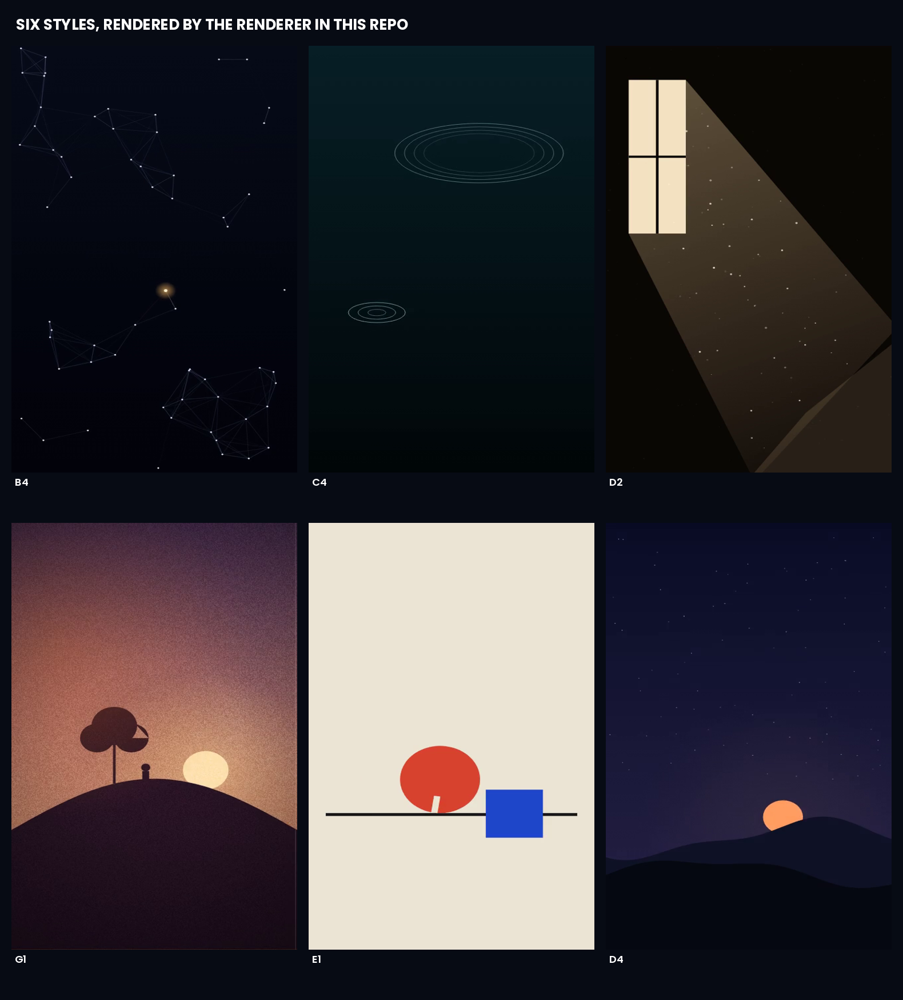

<div align="center">



**341 ways to make a video look like something — and the code for 28 of them.**

[](INDEX.md)
[](styles/)
[](preview/sample-15s.mp4)
[](README.fa.md)

</div>

---

## What this is

A working **style library for code-rendered video**. Every entry answers three questions before you write a
line of motion code: *what does it look like*, *what does it suit*, and *what are the keywords*. Twenty-nine
of them also ship a runnable canvas-2D implementation, so the answer to "make it feel like this" is a
function call, not a prompt to a video model.

<div align="center">

</div>

These six frames are not mockups — they were rendered by `tools/render_style.py` from the code in `styles/`.

## Quick start

```bash
git clone https://github.com/ahmadvahidi/code-animation-atlas.git && cd code-animation-atlas

python3 tools/pick_style.py "calm ending, hope" --coded-only   # shortlist by topic
python3 tools/render_style.py B5 --out clip.mp4 --frames 36 --size 720x1280 --duration 3
python3 tools/make_sample.py --out sample.mp4                  # the 5-scene, 15-second cut
```

`render_style.py` needs nothing but `python3`, `ffmpeg` and a Chromium binary (`CHROME_BIN`). It builds one
HTML page, calls `S.<ID>(ctx, w, h, t, state)` per frame with the state carried across calls — the way these
animations are designed to be driven — pulls the PNG data URLs out of `chrome-headless-shell --dump-dom`,
and encodes with ffmpeg. No playwright, no node, no display.

See the sample: **[preview/sample-15s.mp4](preview/sample-15s.mp4)** (15 s, 720×1280, five styles, crossfaded).

## What is inside

| Group | Count | What it is |
|---|:--:|---|
| A–G code samples | 26 | the coded core: typography, particles, ink, light, geometry |
| M motion | 40 | motion treatments and timing patterns |
| K cartoon | 38 | cartoon and illustration looks |
| Z Chinese | 15 | ink-wash, paper-cut, oriental palettes |
| H layouts | 12 | ready-made compositions for text and data |
| L Lemo-Opuscar | 59 | a curated set of product/film looks |
| V mg-styles | 15 | motion-graphics reference styles |
| X code-video | 31 | code-as-visual: terminals, logs, character art |
| R learned from reference | 7 | reverse-engineered from specific reference works |
| O Oscar 98 | 98 | 98 film-derived looks |

Each file in `styles/` carries `分类` (category), `长什么样` (what it looks like), `适合` (what it suits),
`关键词` (keywords), the prompt itself, and — when present — a ```js``` reference implementation.
`INDEX.md` is the flat list by group; `index.json` is the same data for tooling.

## Licence — two parts, both matter

- **The style library (prompts, descriptions, reference code)** comes from
  [`XiaoyeCodes/code-animation-prompts`](https://github.com/XiaoyeCodes/code-animation-prompts) and keeps its
  own terms: **free to use and share, never repackaged or sold** as a course, paid skill or paid product, with
  attribution to the source. Full text in [UPSTREAM-LICENSE.md](UPSTREAM-LICENSE.md).
- **The tooling in this repository** (`tools/`, artwork) is MIT — see [LICENSE](LICENSE).

Use it to make videos. Do not use it to sell the library.

## How this repo was built

Mirrored from upstream at commit `main` (2026-10-29), prompts only (the 193 reference stills are 80 MB and
stay upstream). Prompts were fetched file by file, the shared canvas utilities hoisted to `styles/_shared.js`,
and every scene in the sample rendered locally — the QA was a per-frame luma scan plus a vision read of five
sample frames, not a glance at the thumbnail.

## Contributing

Add a style as `styles/<ID>.md` with the five fields above; if you include code it must run under
`render_style.py` unchanged (`S.<ID>(ctx, w, h, t, state)`, no external assets). Regenerate `INDEX.md` with
`tools/build_index.py` and keep the group letter consistent.
